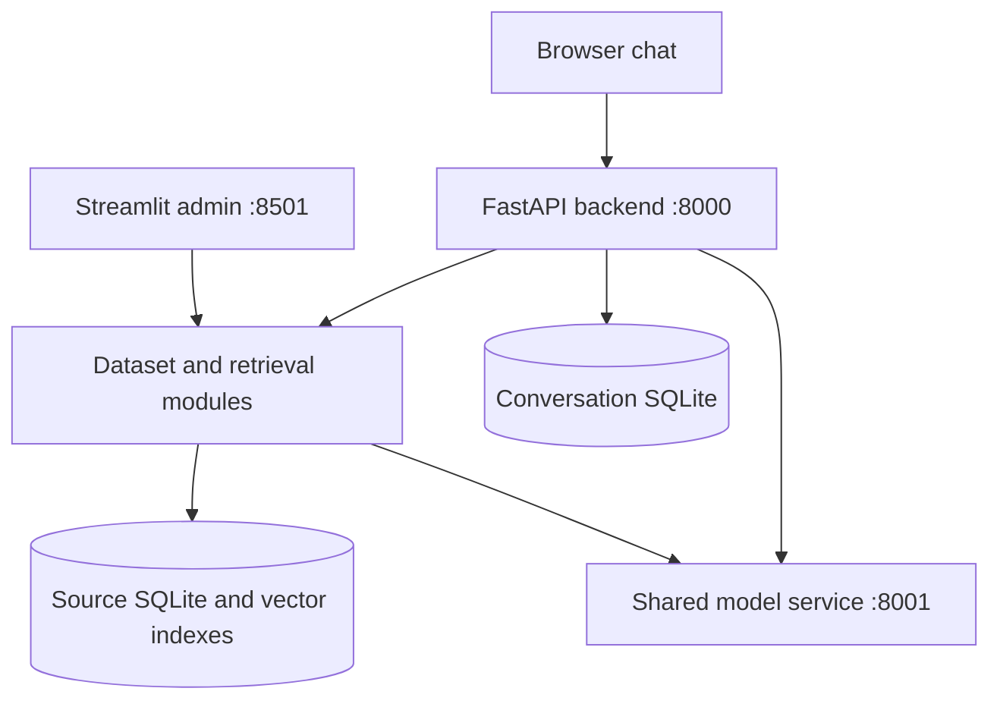
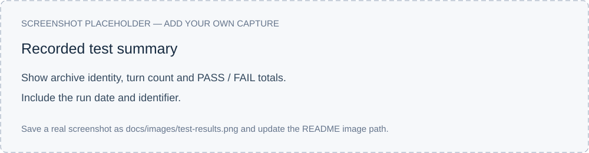

# Legal LLM

A Vietnamese AI assistant that answers questions using uploaded datasets. Originally built for administrative procedures, it also supports university services and other structured information.

The system retrieves relevant records, ranks them and uses a local language model to generate answers with source evidence.


*Replace this placeholder with a screenshot showing a question, its answer and the expanded source record.*

## Background

The project began as a Vietnamese administrative-procedure assistant. It was extended to support multiple datasets without maintaining a separate answer pipeline for each domain. The main development focus has been source-grounded answers, consistent conversation context and practical local inference on limited hardware.

## Features

### Dataset-grounded chat

Answers use retrieved source records and stream into the browser as they are generated. Users can inspect the records behind an answer, revisit conversation history and submit feedback. The assistant is designed to acknowledge missing information rather than invent unsupported values.

### Multiple datasets and routing controls

Automatic routing selects the dataset for a question. Users can also select a domain manually, allow topic switching or keep a conversation in its initially detected domain. Resetting the selection lets the system detect a new topic. Dataset profiles define fields, aliases and retrieval settings.

### Follow-up questions

The system tracks the active subjects of a conversation so questions such as “Nộp ở đâu?” can refer to an earlier service. Reference resolution distinguishes a property question from an action change—for example, borrowing an item followed by asking about renewal. Some follow-up cases remain under refinement.

### Retrieval and full context

Query preparation, vector search, candidate merging, reranking and record selection identify relevant evidence. The answering model receives all public fields of the retained records by default. This skips the earlier column-selection call while preserving conditions, fees, units and other available details. Configured excluded fields are withheld.

### Dataset administration

The Streamlit dashboard supports uploading Excel, CSV, TSV, JSON and JSONL data, reviewing field mappings and configuring domain behavior. Ingestion publishes versioned data/index generations, with progress inspection and rollback controls. Existing domains can be updated without changing the application’s answer pipeline.

### Forms and optional external search

Where configured, the assistant can offer procedure forms and handle download actions. Optional MCP search extends lookup beyond local records through the configured permission flow. Gemini can propose a profile for a new dataset; the profile can be reviewed before ingestion.

### Diagnostics

Service logs, request timings, saved conversation diagnostics and response feedback support debugging. The comprehensive test runner exports questions, responses and checks together, making it possible to compare builds and inspect failures.

## Architecture



A question passes through domain routing, reference resolution when needed, retrieval/reranking and answer generation. The model service hosts Qwen and the shared DirectML embedding/reranker runtime. Dataset records and indexes are isolated by domain and ingestion generation.


*Show a conversation moving from administrative procedures to library services, with automatic switching enabled.*

## Models and stack

| Component | Technology |
|---|---|
| Language model | Qwen3.5-4B, IQ4_XS GGUF |
| Local inference | llama-cpp-python with Vulkan |
| Embedding model | BAAI/bge-m3 |
| Reranker | BAAI/bge-reranker-v2-m3 |
| Retrieval inference | ONNX Runtime with DirectML |
| Backend / admin | FastAPI / Streamlit |
| Optional dataset-profile proposal | Gemini |

Qwen runs with a **4,096-token context window**. Full context means all public fields of the selected records, rather than the entire dataset.

## Setup

The current local setup targets **Windows and Python 3.12**, with Vulkan and DirectML support.

From the project root:

```bat
py -3.12 -m venv env
env\Scripts\activate.bat
python -m pip install -r requirements.txt
```

Download `Qwen3.5-4B-IQ4_XS.gguf` from the [model repository](https://huggingface.co/bartowski/Qwen_Qwen3.5-4B-GGUF) and save it as `models/qwen3.5_4b.gguf`.

Create `.env`:

```dotenv
LLM_SERVICE_URLS=http://localhost:8001
MODEL_PATH=models/qwen3.5_4b.gguf
CHAT_MODE=strict
LOG_LEVEL=INFO
```

Full context and LLM port 8001 are already defaults. Add a private `GEMINI_API_KEY` only if using Gemini-assisted onboarding. Never commit real keys.

On a new machine, prepare the retrieval models:

```bat
python -m rag.prepare_gpu --export
```

Start the application:

```bat
start_all_services.bat
```

After Qwen is ready, run the following from another activated terminal. Skip export/validation if the existing GPU artifacts are already validated for the installed runtime.

```bat
python -m rag.prepare_gpu --validate
```

- Chat: <http://localhost:8000/chat>
- Admin: <http://localhost:8501>
- API docs: <http://localhost:8000/docs>

## Usage

Open the chat interface, enter a demo username and choose automatic routing or a specific domain. Enable switching if you want to move between datasets in the same conversation.

Example questions:

- `Đăng ký khai sinh mất bao lâu và lệ phí bao nhiêu?`
- `Ở thư viện Demo, mỗi lần được mượn mấy cuốn và trong bao lâu?`
- `Ở Xưởng Nhỏ Trạm Mây, mỗi lượt được mượn tối đa mấy máy khoan và giữ trong bao lâu?`

Inspect the attached source record after an answer. Use the history panel to reopen conversations and the feedback controls to flag an unsuitable response.

Use existing ingested data, or upload a dataset through the admin dashboard and review its field mappings before ingestion. Reingesting an existing domain replaces its active dataset after successful publication.


*Replace with a screenshot of dataset configuration or ingestion status.*

## Testing and current results

With services running:

```bat
testing\run_comprehensive_tests.bat
```

The suite runs **64 turns** and saves questions, responses and diagnostics to `qa_exports/`.

The last completed run on **20 October 2026** passed **58/64 automatic checks**. Average response time was **10.51 seconds** with full context versus **11.99 seconds** with field selection. These are single sequential runs, not a concurrency benchmark.

The routing patch prepared on 21 October passed **123 offline checks**; its live results are pending. These offline checks use mocked model/external I/O and do not establish live accuracy.

Manual review of the latest 64 responses found **58 correct/acceptable, 4 partial and 2 incorrect**. The suite includes repeated questions, greetings and appropriate refusals, so the result is not an accuracy estimate over 64 independent factual questions.



*Show the actual run identifier and PASS/FAIL summary. Match the screenshot to the tested code version.*

## Development progress

| Stage | Work completed | Evidence |
|---|---|---|
| Initial assistant | Administrative-procedure chat, conversation storage and source-based responses | `[Add original commits / PRs]` |
| Multiple datasets | Domain profiles, routing controls and dataset administration | `[Add commits / PRs and admin screenshot]` |
| Local model change | Moved from the earlier 1.7B model to Qwen3.5-4B IQ4_XS | `[Add model-change commit]` |
| Context comparison, 20 Oct | Compared selected fields with full context; retained full context as the default | Test archives below |
| Service/test organization, 20 Oct | Aligned the model service on port 8001 and consolidated live testing under one launcher | `[Add commits / PRs]` |
| Routing refinement, 21 Oct | Prepared focused renewal-follow-up and unaccented-input changes | 123 offline checks; live validation pending |

Recorded comparison archives:

- Field selection: `system_tests_20261020T050649_179559Z.zip`.
- Latest completed full-context run: `system_tests_20261020T081538_831156Z.zip`.

`[Add links to the retained test summaries/archives, relevant commits and the demonstrated branch/commit SHA.]` Preserve the original repository history so these changes can be traced. The 20 October metrics belong to that tested build and should not be presented as a post-patch result.

## Current limitations

- The last completed live run contained follow-up and unaccented-library routing failures. The focused patch still needs a live comparison.
- Some responses omit a specific service desk or add unnecessary caveats. Clarification and domain-lock explanations can be improved.
- One automatic room-answer failure was a checker false positive; automated checks require manual interpretation.
- Low available memory can prevent the reranker from loading and produce HTTP 503 responses. The model-file size is not the total runtime memory requirement.
- Concurrent-user capacity and full acceptance coverage of admin, form downloads and external search have not been established by the 64-turn suite.
- Login currently uses a demonstration identifier flow, not production authentication.

## Project folders

| Folder | Contents |
|---|---|
| `backend/` | API, chat UI, admin and conversation handling |
| `llm_service/` | Qwen and shared retrieval-model service |
| `rag/` | Ingestion, profiles and retrieval |
| `data/` | Dataset configurations and ingestion generations |
| `models/` | Local model files, excluded from Git |
| `testing/` / `tests/` | Live regression suite / developer checks |
| `logs/` | Service output and diagnostics |

Model files and ingested databases/indexes are separate runtime assets. Source code alone does not include them. Keep the working dependency versions and dataset handoff instructions with the project.

## Team

**Team:** `[team name]`  
**Original repository:** `[repository URL]`  
**Development branch:** `[branch]`  
**Demonstrated commit:** `[full commit SHA]`  
**Reviewer access:** `[invitation/access status for Anla6204]`

| Member | GitHub | Contribution |
|---|---|---|
| `[Name]` | `@username` | `[Actual contribution]` |
| `[Name]` | `@username` | `[Actual contribution]` |

Add every team member and link their actual contributions to commits, pull requests or issues. Use the original development repository and record any additional repository links here.

## License

Project code: [MIT](LICENSE). Model weights retain their upstream licenses.
