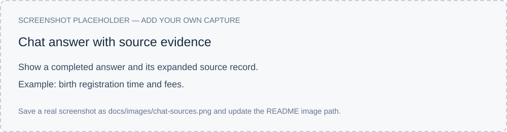
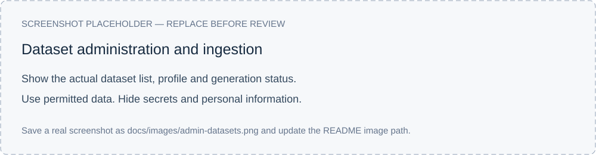
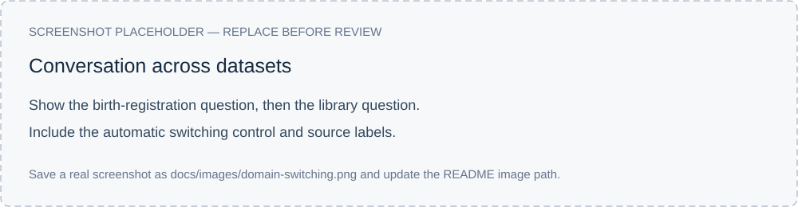
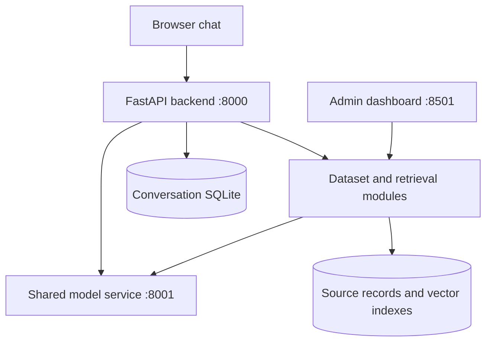

# Legal LLM

**A Vietnamese AI assistant for your own datasets.**

Ask about administrative procedures, university services or other structured information. Get streamed answers with source records you can inspect, and manage your datasets through a web dashboard.

[Features](#features) · [Quick start](#quick-start) · [Models](#models-and-stack) · [Documentation](#documentation) · [Team](#team)



<!-- Replace with an actual screenshot of a completed answer and its expanded source record. -->

## Features

- **Answers with sources.** Inspect the records used to answer a question, including available fees, requirements, conditions and locations.
- **Multiple datasets.** Use the same chat interface for different domains. Automatic routing selects a dataset, or you can choose one yourself.
- **Conversation context.** Ask follow-up questions without repeating the service name. Control whether a conversation can switch topics or stays in one domain.
- **Local AI inference.** Run Qwen locally, with GPU acceleration for generation, embedding and reranking.
- **Dataset management.** Upload Excel, CSV, TSV, JSON or JSONL files. Review field mappings and configure how each dataset is searched and presented.
- **Versioned ingestion.** Track ingestion progress, inspect dataset generations and roll back to an earlier version.
- **Chat history and feedback.** Reopen conversations and flag answers that need improvement.
- **Forms and external search.** Offer configured procedure forms and optionally use MCP search through the permission flow.
- **Diagnostics.** Review service logs, request timings and exported test conversations when investigating a problem.



<!-- Replace with an actual screenshot of dataset configuration or ingestion progress. -->

## Quick start

The current local setup uses **Windows, Python 3.12, Vulkan and DirectML**.

### 1. Install

Run in Windows Command Prompt:

```bat
git clone https://github.com/h-nam-sys/Legal_LLM.git
cd Legal_LLM
py -3.12 -m venv env
env\Scripts\activate.bat
python -m pip install -r requirements.txt
```

### 2. Configure

Download `Qwen3.5-4B-IQ4_XS.gguf` from the [GGUF model repository](https://huggingface.co/bartowski/Qwen_Qwen3.5-4B-GGUF) and save it as `models/qwen3.5_4b.gguf`.

Create `.env` in the project root:

```dotenv
LLM_SERVICE_URLS=http://localhost:8001
MODEL_PATH=models/qwen3.5_4b.gguf
CHAT_MODE=strict
LOG_LEVEL=INFO
```

**First installation:** follow the [setup guide](docs/SETUP.md) to export the retrieval models before startup, validate them afterward and add your first dataset. Model weights and ingested databases/indexes are separate runtime assets.

### 3. Start

```bat
start_all_services.bat
```

| Interface | Address |
|---|---|
| Chat | <http://localhost:8000/chat> |
| Admin dashboard | <http://localhost:8501> |
| API documentation | <http://localhost:8000/docs> |

Keep the launcher terminal open. Press **Ctrl+C** to stop the services.

## Usage

Open the chat page, enter a demo username and select automatic routing or a specific dataset. Enable topic switching when you want to move between datasets in one conversation.

With the corresponding demo datasets loaded, try:

```text
Đăng ký khai sinh mất bao lâu và lệ phí bao nhiêu?
```

```text
Ở thư viện Demo, mỗi lần được mượn mấy cuốn và trong bao lâu?
```

Expand the source record beneath an answer to inspect its evidence. Use the admin dashboard to add your own data or adjust a dataset’s configuration.

<details>
<summary>Conversation across datasets</summary>



<!-- Replace with an actual conversation showing two datasets, with switching enabled. -->

</details>

## Models and stack

| Component | Technology |
|---|---|
| Language model | Qwen3.5-4B, IQ4_XS GGUF; 4,096-token application context |
| Generation runtime | llama-cpp-python with Vulkan |
| Embeddings | [BAAI/bge-m3](https://huggingface.co/BAAI/bge-m3) |
| Reranker | [BAAI/bge-reranker-v2-m3](https://huggingface.co/BAAI/bge-reranker-v2-m3) |
| Retrieval runtime | LlamaIndex, ONNX Runtime and DirectML |
| Backend / admin | FastAPI / Streamlit |
| Storage | SQLite and persisted vector indexes |
| Optional integrations | Gemini for dataset-profile proposals; MCP for external search |

## Architecture



The backend selects a dataset, resolves conversational references and retrieves relevant records. The shared model service provides generation, embeddings and reranking. Responses and their sources are saved with the conversation.

## Testing and project status

With services running:

```bat
testing\run_comprehensive_tests.bat
```

The suite runs **64 turns** and saves prompts, responses and diagnostics under `qa_exports/`.

The last completed live run, on **20 October 2026**, passed **58/64 automatic checks**, with a mean complete-response time of **10.51 seconds**. Follow-up routing, unaccented questions and answer completeness remain areas of active development. The subsequent routing patch has passed offline checks and awaits live validation.

See [development and evaluation notes](docs/DEVELOPMENT.md) for the background, recorded results and contribution evidence.

## Documentation

- [Setup, GPU preparation and dataset ingestion](docs/SETUP.md)
- [Development progress and evaluation](docs/DEVELOPMENT.md)
- [Screenshot replacement guide](docs/SCREENSHOTS.md)
- [Issues and bug reports](https://github.com/h-nam-sys/Legal_LLM/issues)

For a bug report, include the question, selected domain, expected behavior and relevant logs. Remove secrets and private records before sharing diagnostics.

## Team

**Team:** `[team name]`

| Member | GitHub | Responsibilities |
|---|---|---|
| Nguyen Hai Nam | [@h-nam-sys](https://github.com/h-nam-sys) | System architecture, backend development, RAG integration and refinement, task coordination, experiment review and system debugging. |
| Nguyen Minh Thinh | [@minhthinhn](https://github.com/minhthinhn) | Development of the initial working RAG module; ongoing research and paper development. |
| Le Thien Khang | [@thienkhang1234](https://github.com/thienkhang1234) | Model selection, fine-tuning and quantization experiments, AI evaluation; ongoing research and paper development. |

Contributions and development history are available in the [commit history](https://github.com/h-nam-sys/Legal_LLM/commits) and [pull requests](https://github.com/h-nam-sys/Legal_LLM/pulls).

## License

Project code is distributed under the [MIT License](LICENSE). Model weights and dependencies retain their respective upstream licenses.
